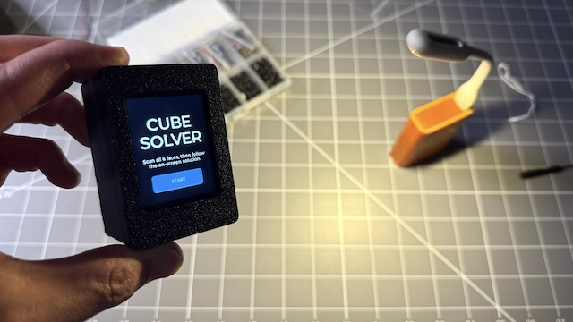
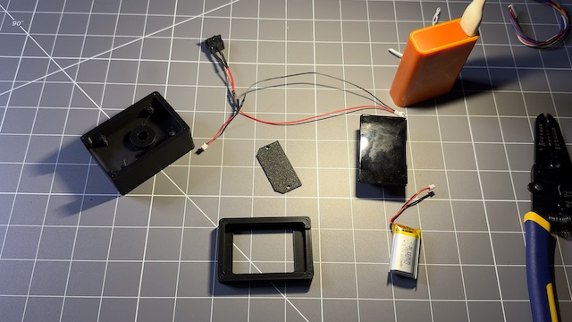

# cube_solver — Rubik's Cube Solver on ESP32-S3

A standalone Rubik's cube solver that runs entirely on an ESP32-S3. Point each
face at the built-in camera, and the device scans the colors, validates the
cube state, computes a solution, and walks you through it move by move on the
LCD — no phone app, no cloud, no host PC.

[Waveshare ESP32-S3-Touch-LCD-2](https://www.waveshare.com/esp32-s3-touch-lcd-2.htm?&aff_id=116255)

[Watch the demo video](https://youtu.be/dRtKP-6v5lA)



---

## Hardware

| Component | Part |
|-----------|------|
| Board | [Waveshare ESP32-S3-Touch-LCD-2](https://www.waveshare.com/esp32-s3-touch-lcd-2.htm?&aff_id=116255) (2" Display + OV5640) |
| MCU | ESP32-S3 (PSRAM) |
| Display | ST7789 SPI LCD, 240×320 |
| Camera | OV5640 (HVGA 480×320, RGB565) |
| Touch | CST816S I2C capacitive touch |
| Backlight | LEDC PWM |

> The OV5640 supports up to 2592×1944 (5MP), but this project captures at 480×320 (HVGA) since that's sufficient for pip detection and keeps frame rate high.



---

## Features

- **Guided 6-face scan** — on-screen instructions tell you which face to show
  and how to rotate the cube between steps (F → R → B → L → U → D)
- **Live HSV color sampling** at 3×3 grid points, updated as you hold the cube
  up to the camera, so the grid overlay previews the detected colors before
  you capture
- **Per-face review screen** — capture a face, check the 3×3 preview, and tap
  any cell to manually correct a misread color before confirming
- **Full state validation** — sticker counts, valid edge/corner piece
  combinations, corner-twist / edge-flip parity, and permutation parity are
  all checked before solving; on failure the UI points at the specific face
  to rescan
- **Step-by-step solve guide** — one move at a time, with a 2D unfolded net of
  the whole cube, an arrow showing which layer to turn, and a plain-English
  hint ("Right column: turn UP")
- **Step back/forward** through the solution to re-check a move
- Dual-core architecture: live camera preview never blocked by detection or
  solving

---

## App Flow

```
START -> SCAN (6 faces, one at a time)
           |  CAPTURE -> REVIEW (tap a cell to fix its color) -> OK
           v
        [all 6 faces scanned] -> validate
           |
           +-- invalid --> ERROR ("rescan face X" or "rescan all")
           |
           +-- valid ----> GUIDE (step-by-step moves + 2D net) -> DONE
```

This state machine lives in [`main/cube_app.c`](main/cube_app.c), driven by
LVGL widgets built once at startup and shown/hidden per state.

---

## Color Detection

[`main/cv_cube.cpp`](main/cv_cube.cpp) samples a small pixel patch (default
12×12) at each of the 9 grid-cell centers, per face:

1. Extract the patch from the byte-swapped RGB565 camera frame
2. `cv::cvtColor` RGB → HSV (via the same
   [`opencv-mobile-prebuilt-newlib`](https://components.espressif.com/components/100312dog/opencv-mobile-prebuilt-newlib)
   component used for classical CV on other ESP32 projects — no extra CMake
   wrangling, just `#include <opencv2/imgproc.hpp>`)
3. `cv::mean` over the patch
4. Classify by (S, V) whiteness test, then hue bands, into one of 6 cube
   colors

HSV separates hue from brightness, which makes classification far more
lighting-robust than raw RGB distance. Red/orange remain the hardest pair to
tell apart — thresholds are tunable `#define`s at the top of the file, and
the manual per-cell picker on the review screen is the fallback when the
camera gets it wrong.

---

## Cube Model & Solver

### Model ([`main/cube_model.c`](main/cube_model.c))

Standard 54-facelet representation, kociemba face order `U R F D L B`. Moves
are encoded as `face*3 + (turns-1)`. `cube_validate()` checks sticker counts,
that every edge/corner facelet combination is a piece that actually exists on
a real cube, and that corner-twist / edge-flip / permutation parity are all
consistent — catching mis-scans before they ever reach the solver.

### Solver ([`main/cube_solve.c`](main/cube_solve.c))

A table-free, beginner (layer-by-layer) method sized to run comfortably on
the ESP32-S3 — no precomputed lookup tables, no whole-cube rotations, so
every move stays in the same U/R/F/D/L/B frame the cube was scanned in:

1. Bottom cross — budgeted IDDFS per edge, case-logic fallback
2. Bottom corners — lift + budgeted IDDFS, sexy-move fallback
3. Middle-layer edges — standard left/right insertion algorithms
4. Top cross — `F R U R' U' F'` with case positioning
5. Top corners: orient — 2-look OLL (IDDFS over U / Sune / Anti-Sune)
6. Top corners: place — IDDFS over U^k · A-perm · U^-k
7. Top edges: place — IDDFS over U^k · U-perm · U^-k

Each stage preserves everything the earlier stages solved, and every move is
tagged with its stage so the UI can show learning context alongside the raw
move. The small per-piece searches trim roughly 25–30% off the move count a
pure textbook algorithm would produce. `cube_simplify()` then merges
same-face turns (including across an interleaved opposite-face move).

Verified on the host against tens of thousands of random scrambles — see
[`test/host/test_solver.c`](test/host/test_solver.c).

---

## Project Structure

```
cube_solver/
├── main/
│   ├── main.c          # Display/camera/touch init, LVGL setup, FreeRTOS tasks
│   ├── cube_app.c/.h    # UI state machine (scan/review/error/guide/done)
│   ├── cube_model.c/.h  # 54-facelet cube representation + validation
│   ├── cube_solve.c/.h  # Layer-by-layer solver
│   ├── cube_vision.h    # Color-sampling interface
│   ├── cv_cube.cpp      # OpenCV HSV color classification
│   ├── CMakeLists.txt
│   └── idf_component.yml
├── test/host/           # Portable (non-ESP) solver test harness
├── 3d_printing/         # OpenSCAD case + STLs for a portable enclosure
├── partitions.csv       # Single large app partition (16 MB flash)
└── sdkconfig
```

### Dual-task architecture

```
Core 0 — camera_task
  └─ Captures a frame continuously, drives the live LVGL preview
  └─ Every 250 ms while a scan screen is active: copies the frame to
     detect_buf and signals detect_task

Core 1 — detect_task
  └─ Blocks on the frame-ready semaphore
  └─ Samples the 3x3 grid + HSV classification (cube_app_on_frame)
  └─ Never touches LVGL — only writes into a plain color array, which an
     LVGL timer reads to update the grid overlay border colors
```

The display task never waits on color sampling, so the live camera preview
stays smooth regardless of detection timing.

---

## Tuning

| Constant | File | Purpose |
|----------|------|---------|
| `WHITE_SAT_MAX`, `WHITE_VAL_MIN` | `cv_cube.cpp` | White vs. colored threshold |
| `HUE_RED_MAX` … `HUE_RED_WRAP` | `cv_cube.cpp` | Hue band boundaries per color |
| `GRID_CELL`, `GRID_X0`, `GRID_Y0`, `SAMPLE_BOX` | `cube_app.c` | On-screen scan grid geometry |
| `SCAN_MIRROR_X` | `cube_app.c` | Set to `1` if the live preview is left/right mirrored vs. the real cube (sensor `hmirror`) |

Scan order/orientation convention: faces are scanned F → R → B → L → U → D
with the top face held fixed, four 90° rotations about that axis, then the
cube tilted forward (U) and backward 180° (D). Following this convention
exactly is what makes the row-major camera sample order line up with the
solver's facelet layout.

---

## Dependencies

| Component | Version |
|-----------|---------|
| ESP-IDF | ≥ 5.5 |
| lvgl/lvgl | ^9.5.0 |
| espressif/esp_lvgl_port | ^2.8.0 |
| espressif/esp32-camera | ^2.1.7 |
| espressif/esp_bsp_generic | ^3.1.1 |
| espressif/esp_lcd_touch_cst816s | ^1.1.1 |
| 100312dog/opencv-mobile-prebuilt-newlib | ^0.2.1 |
