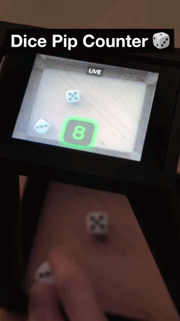
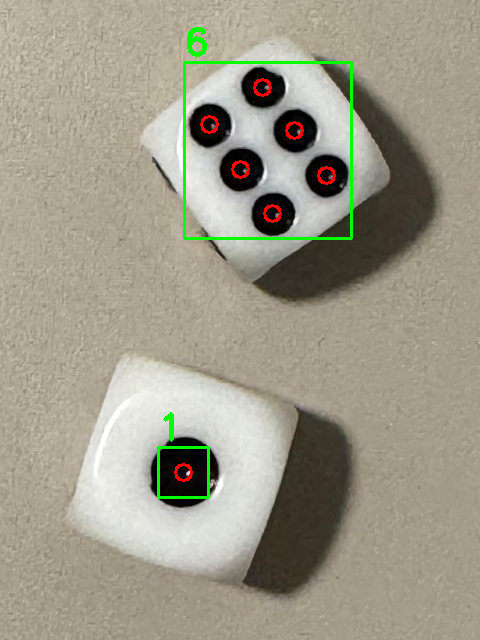
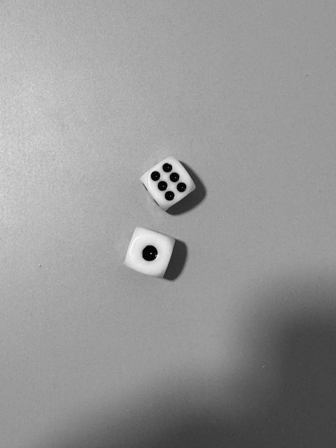
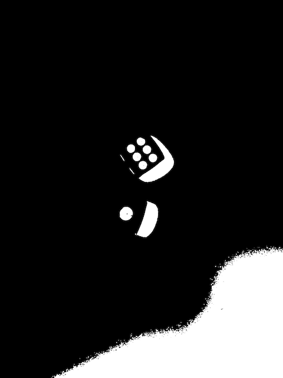
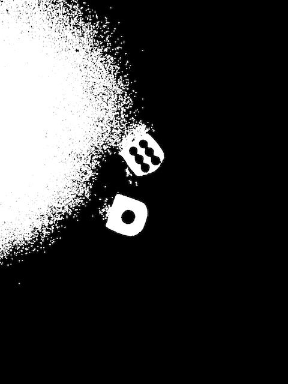
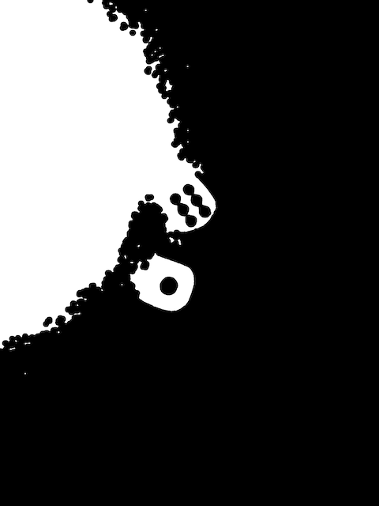
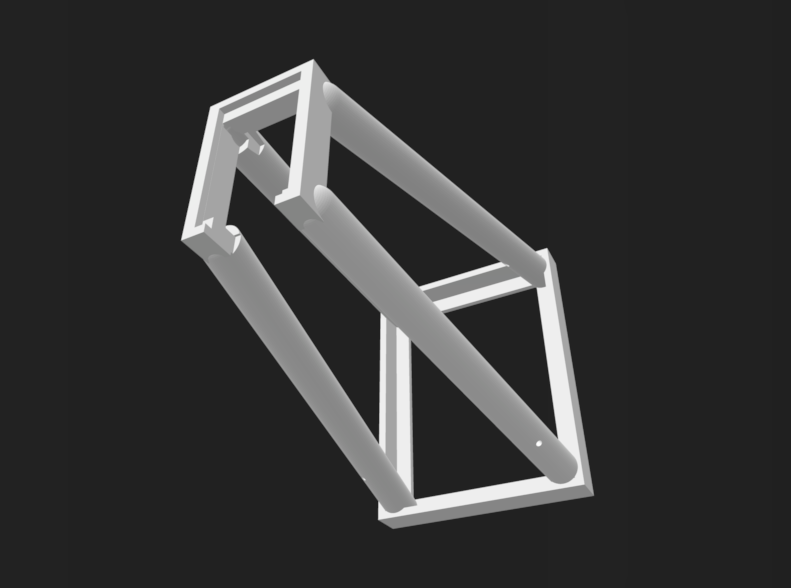
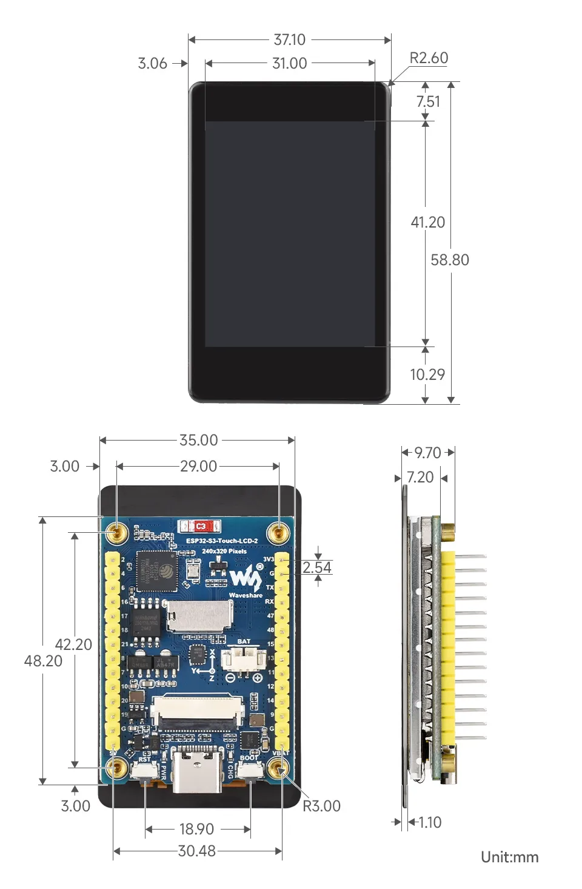

# Dice Dice — Real-Time Dice Pip Counter on ESP32-S3

A real-time dice pip detection system running fully on an ESP32-S3. The device captures live video from an OV camera, detects dice pips using a classical computer vision pipeline powered by **OpenCV**, and displays the total eye count as a large game-style overlay on an LCD screen — all without any cloud or host PC involvement.



[Watch the demo video](https://youtu.be/1KdL57JlomE)




---

## Hardware

| Component | Part |
|-----------|------|
| Board | [Waveshare ESP32-S3-Touch-LCD-2](https://www.waveshare.com/esp32-s3-touch-lcd-2.htm?&aff_id=116255) (2" Display + OV5640) |
| MCU | ESP32-S3 |
| Display | ST7789 SPI LCD, 240×320 (landscape 320×240) |
| Camera | OV5640 (HVGA 480×320, RGB565) |
| Touch | CST816S I2C capacitive touch |
| Backlight | LEDC PWM |

> The OV5640 supports up to 2592×1944 (5MP), but this project captures at 480×320 (HVGA) since that's sufficient for pip detection and keeps frame rate high.

---

## Features

- **Live camera preview** at ~15 fps on the LCD
- **Pip detection** running every 500 ms on a dedicated FreeRTOS task (Core 1)
- **Large game-style number** display (Montserrat 48 px) showing total eyes
- **Color-coded result** — gray → cyan → green → yellow → orange as the count rises
- **Fade-in animation** each time the detected count changes
- **Dynamic glow** — shadow color matches the text color
- **Touch to cycle debug views**: LIVE → Gray → Otsu → Morph → Result overlay
- Dual-core architecture: display never blocked by CV processing

---

## OpenCV on ESP32 via `opencv-mobile-prebuilt-newlib`

Running OpenCV on a microcontroller used to require a painful manual cross-compilation process. This project uses the **[`opencv-mobile-prebuilt-newlib`](https://components.espressif.com/components/100312dog/opencv-mobile-prebuilt-newlib)** component, which provides a prebuilt, stripped-down OpenCV library targeting the ESP32 newlib toolchain.

Adding it is a single line in `main/idf_component.yml`:

```yaml
dependencies:
  100312dog/opencv-mobile-prebuilt-newlib: ^0.2.1
```

This makes standard OpenCV functions like `cv::GaussianBlur`, `cv::threshold`, `cv::morphologyEx`, and `cv::connectedComponentsWithStats` directly available in C++ source files — no extra CMake wrangling needed. The `main/cv_dice.cpp` file simply includes `<opencv2/core.hpp>` and `<opencv2/imgproc.hpp>` and calls them as-is.

---

## Detection Pipeline

The pip detector (`main/cv_dice.cpp`) uses a classical, lighting-robust pipeline. Because it targets only "small dark circles on a bright face", it works reliably under uneven illumination and varying exposure without any neural network.

### Step 1 — Grayscale conversion

The camera outputs RGB565 in big-endian byte order. Each pixel is byte-swapped before extracting R/G/B channels, then converted to 8-bit luminance using standard weights (`0.299 R + 0.587 G + 0.114 B`).



---

### Step 2 — Otsu threshold + invert

`cv::GaussianBlur` (3×3) smooths noise, then `cv::threshold` with `THRESH_BINARY_INV | THRESH_OTSU` binarizes the image. Otsu's method automatically finds the optimal split point from the histogram — so the threshold adapts to the actual lighting of each frame without any manual tuning.

After inversion, **dark pip dots become white blobs** and the bright die face becomes black.

| Otsu result (dark→white) | Bright regions mask |
|:---:|:---:|
|  |  |

---

### Step 3 — Morphological opening

`cv::morphologyEx` with a 3×3 ellipse kernel and `MORPH_OPEN` (erosion → dilation) eliminates isolated noise pixels that passed the threshold. Genuine pip blobs, being larger and more circular, survive.



---

### Step 4 — Connected components + shape filter

`cv::connectedComponentsWithStats` labels every remaining white blob and returns its area, bounding box, and centroid. Each blob is then tested against three shape criteria:

| Filter | Purpose |
|--------|---------|
| `PIP_AREA_MIN` / `PIP_AREA_MAX_FRAC` | Reject noise (too small) and shadows/background (too large) |
| `PIP_MIN_ASPECT` (≥ 0.55) | Reject elongated blobs — pips are near-circular |
| `PIP_MIN_EXTENT` (≥ 0.55) | Reject crescent-shaped blobs — pips fill their bounding box |

Blobs that pass all three filters are recorded as **pip candidates**.

---

### Step 5 — Union-Find distance clustering

Nearby pip candidates are grouped into a single die using union-find. The clustering distance threshold is derived automatically from the **median pip area** (`diameter × PIP_CLUSTER_FACT`), so it scales with whatever resolution the camera delivers.

Clusters with 1–6 members are accepted as valid dice; anything outside that range is discarded as a false detection.

---

### Step 6 — Result

The total eye count is the sum of all valid cluster sizes. In the debug overlay (touch step 4), accepted pips are drawn as **red circles** and each die gets a **green bounding box** with its pip count.


---

## Debug Touch View

Tapping anywhere on the screen cycles through five visualization modes:

| Step | View |
|------|------|
| 0 — LIVE | Raw camera feed |
| 1 — Gray | Grayscale conversion output |
| 2 — Otsu | Binarized image (pips = white) |
| 3 — Morph | After morphological cleanup |
| 4 — Result | Overlay: red pip circles + green die bounding boxes |

The current step name is shown in the top-center label.

---

## Project Structure

```
dice_dice/
├── main/
│   ├── main.c          # Display, camera, LVGL UI, FreeRTOS tasks
│   ├── cv_dice.cpp     # OpenCV detection pipeline
│   ├── CMakeLists.txt
│   └── idf_component.yml
├── out/                # Pipeline visualization images (Python prototype)
├── partitions.csv      # Single large app partition (16 MB flash)
└── sdkconfig
```

### Dual-task architecture

```
Core 0 — camera_task
  └─ Captures frame every ~1 ms
  └─ Every 500 ms: memcpy to detect_buf, give semaphore
  └─ Always: rotate+crop 90° → rot_buf → LVGL display

Core 1 — detect_task
  └─ Blocks on semaphore
  └─ Runs cv_dice pipeline (~100–300 ms)
  └─ Updates LVGL label + triggers fade-in animation
```

The display task never waits for OpenCV, so the live preview stays smooth regardless of detection latency.

---

## Tuning Parameters

All detection thresholds are `#define` constants at the top of `cv_dice.cpp`:

```c
#define PIP_AREA_MIN       12      // minimum pip pixel count
#define PIP_AREA_MAX_FRAC  0.02f   // max pip area as fraction of frame
#define PIP_MIN_ASPECT     0.55f   // short/long side ratio (circle = 1.0)
#define PIP_MIN_EXTENT     0.55f   // area / bounding-box area
#define PIP_CLUSTER_FACT   2.8f    // cluster radius = pip_diameter × this
#define PIP_MAX_TOTAL      12      // max pips expected (2 dice × 6)
```

Enable `DICE_DEBUG 2` in `cv_dice.cpp` to print per-blob statistics to the serial monitor, which makes it easy to calibrate `PIP_AREA_MIN` and the shape ratios for a given camera distance.

---

## 3D Printing — Dice Capture Frame

To keep the dice at a fixed distance and angle relative to the camera on every capture, a 3D-printable frame is provided in [`3d_printing/`](3d_printing/).

| File | Description |
|------|--------------|
| [`Dice_Frame.stl`](3d_printing/Dice_Frame.stl) | Printable frame that holds the dice at a consistent position/angle in front of the camera |
| [`Preview_Dice_Frame.png`](3d_printing/Preview_Dice_Frame.png) | Render preview of the frame |
| [`ESP32-S3-Touch-LCD-2-details-size.webp`](3d_printing/ESP32-S3-Touch-LCD-2-details-size.webp) | Measured dimensions of the ESP32-S3-Touch-LCD-2 board used in this project, for fitting the frame to the board |





---

## Dependencies

| Component | Version |
|-----------|---------|
| ESP-IDF | ≥ 5.5 |
| lvgl/lvgl | ^9.5.0 |
| espressif/esp_lvgl_port | ^2.8.0 |
| espressif/esp32-camera | ^2.1.7 |
| espressif/esp_bsp_generic | ^3.1.1 |
| espressif/esp_lcd_touch_cst816s | ^1.1.1 |
| 100312dog/opencv-mobile-prebuilt-newlib | ^0.2.1 |
