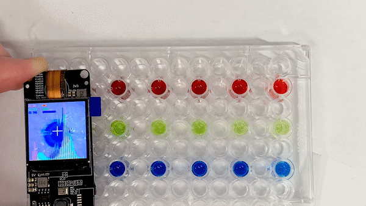

# RGB Pixel Detector & Histogram — ESP32 OpenCV (2022)

> **Note:** This project is no longer maintained. Preserved here for reference.

[Watch the demo on YouTube](https://youtu.be/DNQuCkPtzYA)
[](https://youtu.be/DNQuCkPtzYA)

---

## Overview

This project runs [OpenCV](https://opencv.org/) on an **ESP32** as a standalone device — no Linux SBC, no PC required. It is based on [joachimBurket/esp32-opencv](https://github.com/joachimBurket/esp32-opencv), a cross-compiled OpenCV port for the ESP32.

The application captures a live image from an OV2640 camera and performs two real-time tasks displayed on an ILI9341 LCD:

- **RGB Pixel Detector** — reads the R, G, B values of the center pixel in the frame and displays them on screen
- **Color Histogram** — computes and draws the full-image color histogram in real time

---

## Hardware

| Component | Part |
|-----------|------|
| Board | TTGO T-Camera (ESP32-WROVER) |
| Camera | OV2640 |
| Display | ILI9341 TFT LCD |

TTGO T-Camera module reference: [Xinyuan-LilyGo/esp32-camera-screen](https://github.com/Xinyuan-LilyGo/esp32-camera-screen)

---

## Software Components

| Component | Role |
|-----------|------|
| `esp32-camera` | Espressif camera driver for OV2640 |
| `lvgl_gui` | LVGL v7 — UI widgets and rendering |
| `lcd` | ILI9341 LCD driver (Adafruit GFX based) |
| `opencv` | Cross-compiled OpenCV 4.x (core + imgproc modules) |

The OpenCV library (`main/opencv/`) is pre-compiled for the ESP32 Xtensa LX6 architecture. Only the `core` and `imgproc` modules are included to fit within flash and IRAM constraints.

---

## How It Works

```
OV2640 Camera
     │
     ▼
 Raw Frame (RGB565)
     │
     ├──► Center Pixel RGB Read  ──► Display on LCD (LVGL label)
     │
     └──► OpenCV Mat (grayscale) ──► calcHist() ──► Draw histogram on LCD
```

1. Camera captures a frame via the `esp32-camera` driver
2. The center pixel's RGB value is extracted directly from the raw frame buffer
3. The frame is converted to a grayscale OpenCV `Mat`
4. `cv::calcHist()` computes the histogram
5. LVGL renders both the RGB values and the histogram chart on the LCD

---

## Performance

| Processing | Approx. FPS |
|------------|-------------|
| RGB565 raw frame | ~6 fps |
| Grayscale conversion | ~6 fps |
| Threshold (Binary) | ~6 fps |
| Canny edge detection | ~3 fps |

---

## Build Size

```
Total sizes:
  DRAM .data size:   33536 bytes
  DRAM .bss  size:   74424 bytes
  Used static DRAM:  107960 bytes (  72776 available, 59.7% used)
  Used static IRAM:   79695 bytes (  51377 available, 60.8% used)
  Flash code:      1 096 883 bytes
  Flash rodata:      356 144 bytes
  Total image size: ~1 640 682 bytes (.bin may be padded larger)
```

---

## How to Build

### Prerequisites

- ESP-IDF v4.x installed and configured
- TTGO T-Camera board (or compatible ESP32 with OV2640 + ILI9341)

Setup guide:
- [ESP-IDF VSCode Extension Tutorial](https://github.com/espressif/vscode-esp-idf-extension/blob/master/docs/tutorial/toc.md)
- [Running OpenCV on ESP32 — Full Walkthrough (YouTube)](https://youtu.be/7qPIRBY6C8c)

## Credits

- Original OpenCV ESP32 port: [joachimBurket/esp32-opencv](https://github.com/joachimBurket/esp32-opencv)
- Application & upgrades: [Eric Nam](https://github.com/0015) — [YouTube](https://youtube.com/ThatProject)

---

## License

[MIT License](../../LICENSE)
